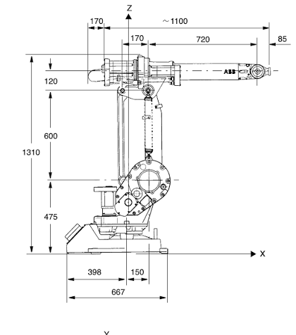

# Examen final — Robótica Industrial · Tema A: ABB IRB 1400

**Análisis de velocidad: Jacobiano geométrico y movimiento en línea recta**

| | |
|---|---|
| Duración | **55 minutos** |
| Valor | **2.5 Pts** |
| Herramienta | MATLAB, **solo código propio** (no se permite ninguna toolbox: Robotics System Toolbox, Peter Corke, Symbolic, etc.) |
| Archivo base | [`AnlVel_NNAA.m`](AnlVel_NNAA.m) |

## Cómo empezar

1. Descargue este repositorio (**Code → Download ZIP**) o clónelo.
2. Renombre `AnlVel_NNAA.m` con sus iniciales (NN = nombre, AA = apellido).
3. En la sección 0 del archivo escriba **su carné completo** y su nombre. Sus valores de **q₀** y del desplazamiento se calculan automáticamente a partir de los **últimos 4 dígitos del carné**. No los cambie: cada estudiante tiene un problema distinto.
4. Complete todas las líneas marcadas con `TODO`.

## Plano del robot (medidas en mm)

> Use el plano para obtener las medidas del robot. No todas las cotas del plano son parámetros DH.

## Límites de la hoja de datos

| Eje | Rango articular | Velocidad máxima |
|---|---|---|
| 1 | −170° a +170° | 110 °/s |
| 2 | −70° a +70° | 110 °/s |
| 3 | −70° a +65° | 110 °/s |
| 4 | −150° a +150° | 280 °/s |
| 5 | −115° a +115° | 280 °/s |
| 6 | −300° a +300° | 280 °/s |

## Enunciado

En el ABB IRB 1400 (6 GDL), con la configuración articular **q₀** y el punto objetivo **P_d = p₀ + Δp** que genera su carné, determine:

1. **(0.4 Pts)** La tabla de parámetros DH y la función `dh()` (matriz homogénea DH estándar). Con ellas se obtiene ⁰₆T(q₀).
2. **(0.8 Pts)** El jacobiano geométrico **J(q)** de 6×6 (función `jacobiano()`), construido columna por columna a partir de **z₍ᵢ₋₁₎** y **p₍ᵢ₋₁₎**:
   Jᵢ = [ z₍ᵢ₋₁₎ × (pₙ − p₍ᵢ₋₁₎) ; z₍ᵢ₋₁₎ ]
3. **(0.3 Pts)** Verificar la parte lineal de J(q₀) con un jacobiano numérico por diferencias finitas sobre la posición de ⁰₆T (h = 1e‑6). Reportar el error máximo.
4. **(0.7 Pts)** Mover el efector final en **línea recta** desde p₀ hasta P_d en T = 2 s, **manteniendo la orientación**, usando **q̇ = J⁻¹ẋ** e integrando con Euler (δt = 0.01 s). Graficar la trayectoria deseada frente a la obtenida sobre el robot.
5. **(0.3 Pts)** Graficar q(t) y q̇(t), completar los límites de la hoja de datos y concluir si algún eje se sale de su rango o supera su velocidad máxima.

## Respuestas en Moodle

Ejecute su código y escriba en el examen de Moodle los valores que imprime:

- Posición inicial **p₀** = ⁰₆T(q₀)(1:3,4) en mm.
- **Posición final obtenida** y **error final respecto a P_d** en mm.
- **Velocidad articular máxima** (°/s) y el eje en que ocurre.

## Entrega

Suba a Moodle una carpeta comprimida con:

1. **`AnlVel_NNAA.png`**: captura de pantalla completa donde se vea MATLAB con el código y la salida (incluida la línea con su carné, fecha y hora), y la sesión activa de Moodle con el examen y su usuario.
2. **`AnlVel_NNAA.m`**: su archivo completo. Debe ejecutarse sin errores y reproducir los valores que escribió en Moodle.
